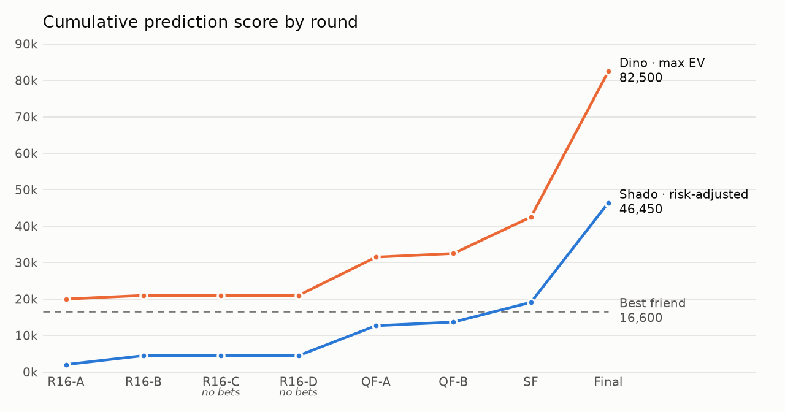
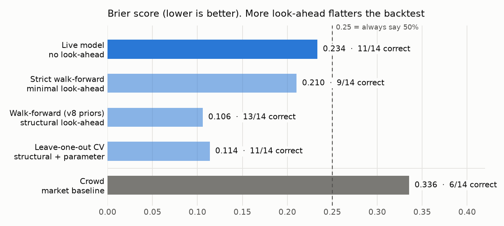
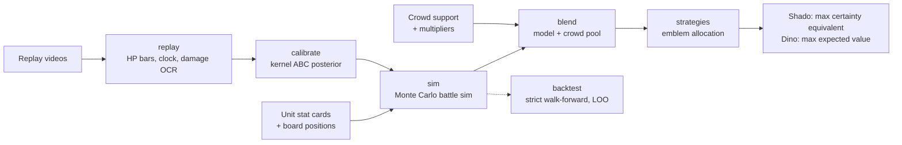

# Predictive Victory Dynamics

**Forecasting and bet sizing under uncertainty: a Monte Carlo battle model, Bayesian calibration to video data, look-ahead-free backtests, and mean-variance position sizing, used live against a crowd-priced market.**

> **11 / 14 matches called correctly out-of-sample, against 6 / 14 for the crowd** · 1st and 2nd on the leaderboard · two long-shot calls in the Final (crowd 14% and 25%, model 91% and 87%) both won, paying ×200 and ×105

The test case was a week-long live prediction event (Oct 12–19, 2026). Players stake emblems on one of two auto-battling armies, and the less popular side pays a higher multiplier: a parimutuel binary bet where the crowd sets the price. I built a simulator from each unit's stat card, calibrated it to frame-by-frame readings of the replays, and sized bets on the sides the crowd under-priced. Background on the event and its rules is in [METHODOLOGY.md §1](docs/METHODOLOGY.md#1-the-problem-a-parimutuel-binary-bet).

## Results

<picture>
  <source media="(prefers-color-scheme: dark)" srcset="charts/points_by_round_dark.png">
  
</picture>

- **11 / 14 correct out-of-sample, against 6 / 14 for the crowd.** Every call was made and logged before the match. When the model and the crowd disagreed, the model was right 6 times out of 7.
- **1st and 2nd on the friends leaderboard** (82,500 and 46,450; best other player 16,600), with one account per strategy as a controlled comparison: max EV against risk-adjusted.
- **The Final made the event.** The crowd gave Mirror Fruity Order 14% and Saurians 25%; the model gave them 91% and 87%. Both won, paying ×200 and ×105.

## Techniques

| Technique | What it does here | Where |
|---|---|---|
| **Agent-based Monte Carlo simulation** | Plays each battle thousands of times on a grid: targeting, AoE, crowd control, elemental reactions, overtime | [`pvd/sim.py`](pvd/sim.py) |
| **Approximate Bayesian computation (kernel ABC)** | Fits the unobservable mechanics to per-second HP curves from 12 replays; predictions average over the posterior | [`pvd/calibrate.py`](pvd/calibrate.py) |
| **Computer vision / OCR signal extraction** | Reads HP bars, the clock, commentary and damage numbers out of 60 fps replay video | [`pvd/replay/`](pvd/replay/) |
| **Avoiding look-ahead bias** | Strict walk-forward backtest: each replay-measured value or mechanic is withheld until the round after its source replay | [`pvd/backtest/walk_forward_strict.py`](pvd/backtest/walk_forward_strict.py) |
| **Cross-validation** | Leave-one-out and walk-forward by importance-reweighting one set of posterior draws, without refitting | [`pvd/backtest/loo.py`](pvd/backtest/loo.py) |
| **Forecast evaluation** | Brier score and log loss for every predictor, scored on the same matches | [`pvd/evaluate.py`](pvd/evaluate.py) |
| **Model stacking with the market** | Model and crowd pooled in log-odds space, with a Beta(2, 2) prior on the weight and a grid posterior | [`pvd/blend.py`](pvd/blend.py) |
| **Expected value and implied probability** | Support rate read as an implied probability; `EV = p·M + (1 − p)·10` and break-even odds per side | [`pvd/strategies.py`](pvd/strategies.py) |
| **Mean-variance utility, risk aversion λ** | Strategy A maximises the certainty equivalent `EV − (λ/2)·Var`; Strategy B maximises EV | [`pvd/strategies.py`](pvd/strategies.py) |
| **Model criticism** | Checks whether real margins of victory look like ordinary draws from the model (59th–65th percentile) | [`pvd/backtest/margin_check.py`](pvd/backtest/margin_check.py) |

## Key insight: the Sharpe ratio was the wrong objective

Strategy A started as max-Sharpe. In round 2 it put 28 emblems on Elemental Dye (78.5% to win, ×105) and 72 on Blazing Beasts (60.5%, ×30), even though Dye was better on both odds and payout.

For a binary bet with a fixed payout floor, Sharpe reduces to `sqrt(p / (1 − p))`, so **the payout cancels out**:

| Bet | Win | Lose | EV | Sharpe |
|---|---|---|---|---|
| 60% to win, pays 50 | 50 | 10 | 34.0 | 1.22 |
| 60% to win, pays 20 (strictly worse) | 20 | 10 | 16.0 | 1.22 |

The max-Sharpe portfolio weights each bet by excess EV / variance. That penalises big payouts, which produced exactly the 28 / 72 split. Sharpe is the right yardstick when a portfolio can be levered to a risk target. Here stakes are capped and can't be levered, so Strategy A switched to optimising the certainty equivalent `EV − (λ/2)·Var` directly, with λ = 2.1e-4 fixed for the rest of the event. The full argument is in [DECISIONS.md §1](docs/DECISIONS.md#1-sharpe-ratio-was-the-wrong-objective-and-i-only-caught-it-by-intuition), and [`tests/test_strategies.py`](tests/test_strategies.py) checks both results.

## Evaluation: avoiding look-ahead bias

The model changed eight times during the event (v1 → v8), and every change was learned from a replay. A backtest of the final model can quietly use what those later replays taught it. So the live record is scored against three backtests that let in progressively more information from after the match:

<!-- scoreboard:start -->
<!-- generated by scripts/make_results.py from data/results/matches.csv, backtest_v8.csv and backtest_strict_wf.csv; do not edit by hand -->

| Predictor | Look-ahead bias | Correct | Brier ↓ |
|---|---|---|---|
| **Live model** | None | **11 / 14** | **0.234** |
| Strict walk-forward | Minimal | 9 / 14 | 0.210 |
| Walk-forward (v8 priors) | Structural | 13 / 14 | 0.106 |
| Leave-one-out CV | Structural + parameter | 11 / 14 | 0.114 |
| Crowd | None | 6 / 14 | 0.336 |

<!-- scoreboard:end -->

<picture>
  <source media="(prefers-color-scheme: dark)" srcset="charts/lookahead_dark.png">
  
</picture>

- **The live record is the headline.** It is the only model row with no look-ahead at all.
- **The strict walk-forward is the fair backtest,** and it lands close to live (9 / 14, Brier 0.210).
- **The leakier backtests look better** (13 / 14, Brier 0.106). The jump from strict to v8 priors comes almost entirely from priors measured in later replays. That's leakage, not skill, and it's why the live record is the number to trust.
- **Could it be luck?** If the model and the crowd were both coin flips, a gap of 5 or more over 14 matches would happen about 4% of the time. That's evidence of a real edge, but 14 matches is a small sample.

Brier score is the mean squared error of the probability (0 is perfect, 0.25 is always saying 50%). Two R16-D matches can't be simulated because their unit cards were never captured, so the record is 14 matches, not 16. Every match is in [RESULTS.md](RESULTS.md).

## How it works



1. **Simulate.** Each battle is played thousands of times. Parameters that can't be read off a card are drawn from the posterior, so the win probability carries the model's uncertainty.
2. **Calibrate.** The replay readers turn video into per-second team HP and alive-unit curves. Kernel ABC keeps the parameter draws whose simulated curves match the real ones.
3. **Blend.** The model is pooled with the crowd's implied probability. Its weight depends on how many of the units have been seen in replays: about 0.6 when all of them have, about 0.35 when key units haven't.
4. **Allocate.** The round's emblems are split by exhaustive search (a coarse grid, then a 1-emblem refinement) to maximise CE for Strategy A or EV for Strategy B.

The [walkthrough notebook](notebooks/walkthrough.ipynb) runs all four steps on the Final in under a minute and reproduces the bets actually placed.

## Repo layout

```
pvd/                       the model package (standard library only)
├── sim.py                 Monte Carlo battle simulator
├── calibrate.py           kernel ABC fit to replay trajectories
├── replay/                video readers: HP bars, clock, commentary, damage-number OCR
├── blend.py               Bayesian log-odds stacking of model and crowd
├── strategies.py          EV, variance, Sharpe; max-CE and max-EV allocation
├── evaluate.py            Brier / accuracy for every predictor
└── backtest/              strict walk-forward, leave-one-out, margin check
notebooks/walkthrough.ipynb  end-to-end run on the Final
tests/                     payout math, the Sharpe result, allocation, track-record regression
scripts/                   rebuild RESULTS.md, the README tables and charts/ from data/
data/
├── raw/                   unit cards, placements, crowd snapshots, replay outcomes, leaderboard
├── processed/             per-frame replay extracts, measured hits, posterior samples
└── results/               live match log (predictions, picks, scores), backtest predictions
docs/                      methodology, decisions, journal, skills, round notes
archive/                   early prototypes, superseded by pvd/
```

## Reproduce

The model uses only the Python standard library. Charts and tests need `pip install -r requirements.txt`. Run from the repo root:

```bash
python -m pvd                                  # list commands
python -m pvd sim SF                           # P(left wins) ± 95% CI and EV per emblem for a round
python -m pvd strategies Final --pool 200 --lambda 2.1e-4 --linw 0.65,0.65
python -m pvd backtest-loo                     # leave-one-out and walk-forward (v8 priors)
python -m pvd backtest-strict 1500 2           # strict walk-forward (~75 min on 2 cores)
python -m pvd calibrate 3000 2                 # refit to every replay
python scripts/make_results.py                 # rebuild RESULTS.md and the tables above
python scripts/make_charts.py                  # rebuild charts/
pytest
```

The CSVs in `data/` are the source of truth. `RESULTS.md`, `charts/` and the generated tables are built from them.

## Documentation

| Doc | What it covers |
|---|---|
| [docs/METHODOLOGY.md](docs/METHODOLOGY.md) | Full write-up: payout math, measured game mechanics, model v1 → v8, the full evaluation, what worked and what didn't, points by round |
| [docs/DECISIONS.md](docs/DECISIONS.md) | Each major decision and why: Sharpe → CE, choosing λ, trust weights, pacing emblems, betting against the crowd |
| [docs/JOURNAL.md](docs/JOURNAL.md) | The dated, as-it-happened log, corrections included |
| [RESULTS.md](RESULTS.md) | Every match: crowd support, multipliers, model call, winner, picks, score |
| [docs/SKILLS.md](docs/SKILLS.md) | The skills the project used, grouped by area: decision theory, market reasoning, simulation, computer vision, data engineering |
| [docs/rounds/](docs/rounds/) | Round-by-round notes from the first rounds: boards, crowd odds, replay observations, why the model missed |
| [archive/](archive/) | Early prototypes (first allocation sweep, first ABC calibrator, first HP-bar tracker), kept for history |
